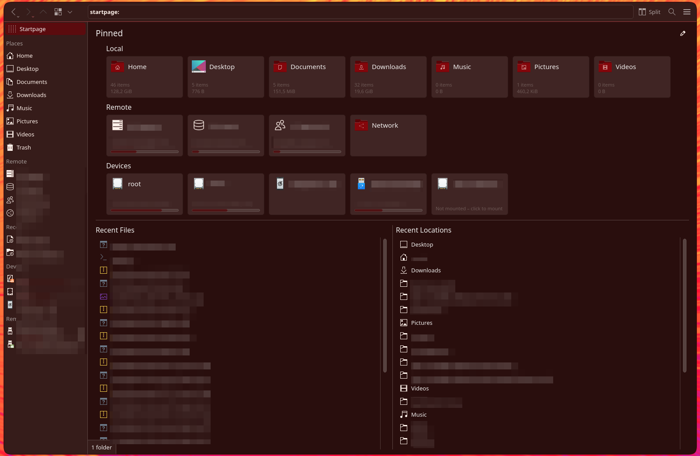

# Dolphin Startpage

> [!WARNING]
> **This is vibe-coded junk.** I made it for my own personal use only.
> It comes with no guarantee of any kind and makes no claim to be stable.
> It hooks into Dolphin internals, so any Dolphin update can break it.
> Use it at your own risk.

A start page for KDE Dolphin, added as a plugin instead of a fork. It shows:

- **Local**: your home folders, plus any folders you add, with item count and folder size
- **Remote**: the entries from *Places → Remote*, with their disk usage as of the last connection
- **Devices**: drives with their free space. USB drives appear when you plug them in and disappear when you remove them. Click an unmounted drive to mount it.
- **Recent Files** and **Recent Locations**

Use the pencil button (top right) to hide or show tiles, turn whole sections on or off, and pin extra folders.
The page opens as `startpage:/`. It has its own row above *Places*, and Dolphin opens it on startup.



## How it works
- `kio_startpage`: a KIO worker that makes `startpage:/` a valid URL.
- `dolphinstartpage`: installed as a `KOverlayIconPlugin`, so Dolphin loads it into its own process.
  It draws the page over every view that shows `startpage:/`.

## Install
Get a build from [Releases](../../releases), or build it yourself (KF6 / Plasma 6):

```sh
./install.sh            # needs cmake, extra-cmake-modules and the KF6 KIO, WidgetsAddons, Config, Solid dev packages
killall dolphin; dolphin
```

Binary release (Arch build shown; there is also a Fedora build):

```sh
sudo tar xzf dolphin-startpage-*-arch.tar.gz -C /
```

Settings are stored in `~/.config/dolphinstartpagerc`.

## Uninstall
1. Remove the two plugin files. This works for both the binary release and a self-built install:
   ```sh
   sudo find /usr/lib /usr/lib64 \( -name dolphinstartpage.so -o -name kio_startpage.so \) -print -delete
   ```
2. Reset the Dolphin settings the plugin changed on its first run (start location and "restore last session"), and delete its own config:
   ```sh
   kwriteconfig6 --file dolphinrc --group General --key HomeUrl --delete
   kwriteconfig6 --file dolphinrc --group General --key RememberOpenedTabs --delete
   rm -f ~/.config/dolphinstartpagerc
   ```
3. Restart Dolphin: `killall dolphin; dolphin`
